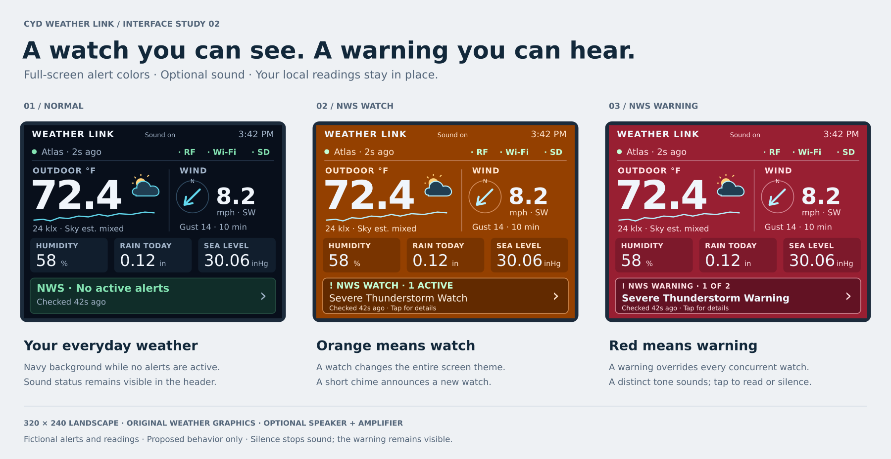

# Home screen concept

Status: interface specification and fictional study previews, with core firmware implemented October 20, 2026. The [firmware scope](firmware/README.md) covers Home v2, full-screen watch/warning themes, alert client/details, gusts, history and setup. Optional audio, calibrated sky estimates, some measurement details and hardware/service acceptance remain open; see [validation](firmware/VALIDATION.md).

This is page 1 of the proposed three-page swipe interface: **Home**, **Trends**
(rolling 24 hours), and **Forecast**. Navigation, shared layout, history, and
forecast behavior are specified in [SCREENS.md](SCREENS.md).



The [original preview](concepts/home-screen.png) also illustrates loss of network service. The revised concept adds full-screen watch/warning themes and optional audible alerts.

The baseline is a **320×240 landscape touchscreen**, matching the proposed display in `PARTS.md`. The preview uses that exact logical resolution, enlarged for review. Validate fonts and touch accuracy on the selected panel before implementation.

## Visual hierarchy

Use a dark navy background in normal operation, warm white numbers, cyan measurement graphics, and restrained green connection indicators. An active NWS watch changes the **entire screen background to orange**; an active NWS warning changes it to **red**. Cards, dividers, and secondary text use matching high-contrast variants. Every color has a text label or symbol. Avoid blinking, marquees, and decorative animations.

| Area | Content and interaction |
| --- | --- |
| Header, y=0–43 | Compact `WEATHER LINK` title, configured callsign/SSID when present, local clock, Atlas health, RF/Wi-Fi states, APRS/CWOP connection text and a trailing speaker/mute icon. Subtle page dots indicate position. No large page-switching banner or permanent header arrows; swipes navigate. |
| Main readings, y=44–135 | Large outdoor temperature, a 60-minute trend, and a small NWS forecast graphic with local lux; current wind speed, compass arrow showing where wind comes **from**, and `Gust 5m` showing the highest received wind reading in the trailing five minutes. Tap either half for field ages, light/UV or wind/gust details. Swipe an outdoor/wind detail to open its trend. |
| Measurements, y=136–183 | Humidity, local-day rain, and sea-level pressure with units. Tap a tile for details: humidity age/source, rain today/hour/24-hour totals and coverage, or pressure availability. Pressure shows `Not fitted` without a barometer. |
| Alert strip, y=184–239 | Highest-priority NWS event and alert count, or explicit check status. Tap anywhere in the strip for the alert list and full text. |

Use approximately 44-pixel or larger touch targets. Keep home reachable with a large Back button on detail pages. UV/light, lightning if fitted, battery, and extended history belong on secondary pages. If no barometer is installed, replace pressure with a supported measurement or show `Not fitted`.

Horizontal swipes in the content area move between the three primary pages.
The alert strip remains a dedicated tap target on every page, and orange/red
themes apply across the interface. See [SCREENS.md](SCREENS.md) for gestures
and detail-page returns. The owner confirmed on October 20 that the main
screen should retain the v2 study's compact status header; the initial
`Home 1/3` banner and arrows were only a bring-up UI and have been removed.

## Graphics grounded in observations

The [weather icon sheet](concepts/weather-icons.png) contains twelve original icons: sunny, partly cloudy, cloudy, rain, heavy rain, thunderstorm, night, cloudy night, snow, fog, windy, and unknown. Editable SVGs and transparent 48×48 PNGs live in `assets/weather/`; [asset notes](assets/weather/README.md) define selection rules and export commands. They share the existing rounded cloud, cyan outline, and warm sunshine style. Rasterize to the display's actual icon size during firmware integration rather than assume a runtime SVG decoder.

Select graphics by source: calibrated lux supports labeled daytime sky estimates; recent rain-counter changes support rain; a defined recent rainfall rate supports heavy rain. A thunderstorm icon requires supported fresh local lightning evidence, or an explicitly labeled external condition source. A thunderstorm **watch or warning describes a hazard area**, not a confirmed storm at the sensor, and belongs in the alert presentation. Snow and fog assets are ready for a future supported source; do not select them solely from temperature, humidity, or darkness. Keep unknown available when evidence is insufficient. Configure precedence when rain/lightning overlaps a sky estimate, and expose the source on the detail page.

The large temperature, sparkline, compass, and estimated-sky graphic provide visual character without sacrificing readable values. Show a rain animation or `Rain detected` only from fresh rain-counter changes over a documented window.

The station has a lux sensor: expose its decoded reading and use it to support **estimated cloudiness**. Proposed approach: compare fresh lux against a calibrated clear-sky illuminance baseline at the station's solar elevation, with valid UTC, latitude/longitude, and a moving average to prevent flicker. Use coarse labels such as `Sky est. bright`, `Sky est. mixed`, and `Sky est. dim`, illustrated with sun/partial-cloud/cloud glyphs. These are inferred lighting conditions, not a measured cloud fraction. Do not assign numerical cloud-cover percentages from lux alone. Record sensor placement and shading; calibrate the baseline over verified clear days and validate labels against observations before enabling the estimate by default. No universal lux cutoffs are assumed.

The preview illustrates a possible calibrated estimate alongside `24 klx`; it does not demonstrate a working classifier. Until calibrated, show a neutral light glyph and lux. At night, low solar elevation, stale lux, invalid time/location, or sensor saturation, show the raw valid reading and `Sky est. —`. Lux alone cannot distinguish cloud from shade, fog, or precipitation reliably; retain that uncertainty on the detail page. A night glyph may indicate calculated nighttime without claiming a clear sky.

The owner reported roughly 15 klx in direct fall midday sun on October 16, 2026.
Retain this as an installation-specific reference, with higher summer readings
an expectation to test; do not hardcode 15 klx as the sunny/cloudy threshold.
Observation provenance is recorded in [CAPTURE.md](CAPTURE.md#reviewing-lux-rain-and-wind).

[AcuRite describes the sensor as measuring illumination at its installation location](https://kbase.myacurite.com/web/content/monitor/sensors/atlas-weather-station.htm?TocPath=Monitoring%7CYour+Dashboard%7C_____1). The cloudiness inference above is a proposed project feature, not an existing Atlas measurement or a validated algorithm. A Wi-Fi outage alone does not invalidate a locally computed estimate while its clock, coordinates, calibration, and lux remain valid.

The preview's sparkline and readings are illustrative, not a claim of measured history. In firmware, suppress a sparkline until enough valid samples exist and leave gaps during outages.

Display `Gust 5m` as the maximum valid wind-speed reading over the trailing
300 seconds, alongside current wind speed. This replaces the earlier proposed
ten-minute display window. Use wind from all applicable Atlas packet types,
deduplicate repeated copies without extending their original observation time,
and expire old peaks as time passes. Show the peak's time/age and history
coverage in the wind detail page. Mark startup/reception gaps as incomplete
coverage; apply wind freshness independently and show `—` once the window has
no valid wind samples. The full behavior and validation cases are specified in
[DESIGN.md](DESIGN.md#displayed-five-minute-wind-gust). Validate sensor sampling
limits before interpreting this maximum as a standard meteorological gust.

## Freshness and connection states

Packet reception and each measurement have independent freshness. A newly received packet cannot refresh fields absent from that packet. Station health shows `Disconnected` after five minutes without a bound-station packet. Mark each field `STALE` after ten minutes without its own update; also show `Data stale` after ten minutes with no change across accepted weather values. This unchanged-data warning does not prove a frozen transmitter. Missing values show `—`; cached values retain age and a visible stale label.

The header reports sensor reception and local Wi-Fi association independently; SD is optional and has no required header indicator. Status details show last RF reception, decoder/station ID, Wi-Fi/IP, time validity, history-checkpoint health, optional logger health when enabled, each configured uploader's last success/error (APRS-IS/CWOP route and individually selected PWS services from [WEATHER_SHARING.md](WEATHER_SHARING.md)), configured serial-output state, and separate NWS alert/forecast check health. CWOP registration/verified ingestion is distinct from local send success. Disabled outputs say `Off`. UART writes mean `Sending`, not confirmed radio receipt. Summarize any upload/storage fault in the header with an amber `!`; keep NWS events visible in their dedicated strip.

## Local NWS alerts

NWS supports active alerts for a configured latitude/longitude through its [point-filtered alerts endpoint](https://www.weather.gov/media/documentation/docs/NWS_Geolocation.pdf). Use station coordinates entered during setup, not IP geolocation or the developer machine's timezone. The location remains unconfigured until supplied.

```text
GET https://api.weather.gov/alerts/active?point={latitude},{longitude}&status=actual
Accept: application/geo+json
User-Agent: CYDWeatherLink/0.1 (project contact URL or email)
```

The [API documentation](https://www.weather.gov/documentation/services-web-api) currently describes free access and a required identifying User-Agent. Normal polling is every 30 seconds, honoring caching and retry headers; NWS [recommends no more than one request per 30 seconds](https://www.weather.gov/documentation/services-web-alerts). Refresh promptly after reconnect without bypassing throttling. Follow only expected HTTPS API redirects and verify TLS certificates.

Run this as a bounded, low-priority network task alongside existing uploaders. Stream/filter JSON to retain alert ID, references, event, headline, area, severity, urgency, certainty, status/message type, sent/effective/onset/expires/ends, description, and instruction. Follow pagination before treating a response as a complete snapshot. Cap retained alerts and text; explicitly display `More alerts` or `Details truncated` if limits are reached. A partial, oversized, or malformed response cannot establish an all-clear. Measure TLS/JSON memory with RF, display, history checkpointing, and all configured uploaders active.

Apply updates/cancellations using IDs and references, deduplicate versions, and exclude test/exercise messages from normal operation. Rank by CAP severity and urgency, with immediate tornado/severe-thunderstorm/flash-flood warnings at the top; retain unknown event types and let the list expose every returned alert. Watches, advisories, and unknown severity receive distinct text labels. Never infer an alert from local sensor values.

An alert detail page shows the official event, affected area, issue/update time, onset/end when supplied, issuing office, and scrollable NWS description and instructions. Use local timezone labels. Preserve the source text, wrap long headlines, and provide an alert-list button with count. Acknowledging an alert records that it was seen; it does not clear it. Optional sound hardware and behavior are defined below.

## Full-screen alert themes

| Confirmed local NWS state | Screen background | Behavior |
| --- | --- | --- |
| No active alerts | Navy `#080F1B` | Normal measurements and last successful check. |
| Watch, with no warning | Orange `#944000` | Persistent `NWS WATCH` label and official event name. |
| Any warning | Red `#981F32` | Persistent `NWS WARNING` label; overrides concurrent watches. |
| Advisory or statement only | Navy | Labeled alert strip with amber accent; do not mislabel it a watch. |
| Unknown event classification | Navy | Show the official event and urgency; keep it in the list. |

These are project UI colors, not the official NWS map palette. Classify known NWS event names into warning/watch/advisory/statement, independently of CAP severity (which is not the product type). Use explicit mappings and a labeled unknown fallback. NWS [distinguishes watches, warnings, and advisories](https://www.weather.gov/sjt/WatchWarningAdvisoryExplained). Choose the overall theme from **all** applicable alerts; then rank events within the chosen category by urgency/severity for the headline. Keep all alerts accessible.

Apply the theme throughout home and detail pages. Change it on validated updates, without flashing. On a failed/stale check, retain the last known orange/red theme with a prominent `NWS UNVERIFIED` label and check age; do not quietly return to navy or imply confirmed ongoing activity. A successful complete snapshot can clear or downgrade the theme. Clearing/changing the configured location invalidates its cache and shows `Set alert location`/`Checking`. Silencing or acknowledging an alert never changes the background.

## Optional audible alerts

Add a speaker and suitable amplifier, or use a verified existing board audio circuit. The proposed ESP32-S3 baseline can use an I²S amplifier such as **MAX98357A** plus a matched small speaker; reserve bit-clock, word-select, and data GPIO, and optionally an amplifier-enable pin. Verify module input levels, supply, speaker impedance/rating, and the whole pin budget before wiring. A speaker must not be driven directly by an ESP32 GPIO. A driven piezo buzzer is an alternative if simple beeps and fewer audio features are preferred. See [PARTS.md](PARTS.md).

Proposed behavior after the user enables and tests audio:

- A newly received actual watch plays one short, original two-note chime.
- A newly received actual warning plays a distinct original three-pulse tone; immediate severe/extreme warnings may repeat every 60 seconds until silenced, cancelled, or no longer confirmed fresh.
- Advisories/statements remain silent by default; an optional setting enables their chime. Unknown classifications remain visible and do not inherit a guessed tone.
- The alert detail page opens when sound starts and provides a large **Silence this alert** button. Stop playback immediately; retain the alert, count, and background. A separate **Mute all** setting persists; a speaker/mute icon beside Wi-Fi shows audio state. Unconfigured audio uses the mute icon.
- Provide volume, enable/disable, a deliberately invoked **Test sound** button, and an optional quiet-hours setting. Quiet hours suppress sound unless an explicit warning override is enabled; never assume they override mute. Make the selected behavior visible in settings.
- Deduplicate by alert identity/update lineage. Routine polling, reconnects, and unchanged updates do not replay tones. A watch-to-warning escalation or materially increased hazard may re-alert, including after the previous version was silenced; document those triggers and persist bounded acknowledgement state to avoid restart loops. A newly discovered fresh alert after reboot can still announce once.
- Stop repeats on stale/unavailable NWS data, message expiry, cancellation, mute, or a location change. Cached alerts and invalid-time startup cannot trigger fresh-alert tones. Resume only after fresh validated data, without replaying an unchanged acknowledged event.

Generate tones locally with bounded nonblocking playback; no cloud speech or SD audio files are required. Use original chimes, not a recording or imitation of the EAS/NOAA warning attention signals. Volume and audibility require an enclosure bench test. Audio remains optional and must not stall RF capture, history updates, rendering, UART output, or networking.

## Alert strip states

- **Fresh complete empty result:** `NWS · No active alerts` plus last successful check age.
- **Active event:** event type, warning/watch/advisory label, count, and check age; tap to read. Do not automatically rotate away from the highest-priority event.
- **Check failed or older than three minutes:** `NWS unavailable` or `NWS data stale`, last successful check age, and a retained-alert badge when applicable. Never display an all-clear while offline.
- **Cached alert:** retain as `Last known / unverified` after a failed check or product expiry; do not continue labeling it confirmed active. `expires` describes message expiry and `ends` describes the event end; they are [not interchangeable](https://github.com/weather-gov/api/discussions/385). A successful complete snapshot resolves current membership.
- **Boot/time invalid/location missing/disabled:** explicitly show `Checking`, `Time unknown`, `Set alert location`, or `NWS off`, respectively.

When a new immediate severe/extreme alert arrives, wake a dimmed display and open its detail page once per new/materially changed alert; let the user return home while retaining the banner and theme. Also open details when an enabled audible alert starts, so Silence is immediately available. Outside those cases, preserve the current page. Use hysteresis for noisy connection failures. Internet-based alerts complement existing warning channels; local measurements and serial weather output continue independently during network loss.

## Acceptance checks

Review the preview at native size and on the real panel. Exercise long event names, multiple alerts, update/cancel, null end times, expired cached messages, empty results, pagination, malformed/oversized payloads, throttling, invalid time, reconnect, and a location change (which invalidates the old cache). Inject stale individual fields while RF remains active. Verify all text fits with Fahrenheit/Celsius and selected pressure units, and that alert fetching never stalls RF reception, history updates, or UART output.

Check normal→watch→warning→watch→clear theme transitions, simultaneous watch/warning priority, advisories, unknown types, and retained unverified themes offline. Verify text contrast on the actual display. Test sound enable/test/volume, immediate silence, mute across reboot, quiet hours/override, duplicate updates, escalation after acknowledgement, cancellation, stale/expired cache, and playback under full receiver/network load. Verify amplifier power draw, brownout behavior, and interference with 433 MHz reception.

## Owner updates — October 20, 2026

- Latest owner revision: main rain tile is **RAIN TODAY**, replacing the
  earlier rolling 24-hour request. Reset at midnight in the configured station
  timezone, including 23/25-hour daylight-saving days. With an existing rain
  baseline, the new day's display becomes `0.00` at midnight without waiting
  for another packet; coverage remains partial until reception confirms it.
  No baseline or valid date means `--`. `*` means partial/uncertain coverage;
  `!` marks stale rain-counter reception. Keep rolling hour/24-hour totals in
  rain details and for eligible service exports. Do not reset the sensor's
  lifetime/modulo counter. Rain spanning midnight has uncertain day allocation
  and prevents complete coverage for that day.
- Main weather graphics use the current NWS hourly forecast, explicitly labeled
  `NWS forecast`; they do not classify clouds from local lux. Hide graphics
  when Wi-Fi or fresh NWS hourly data is unavailable. Raw lux remains local.
- Download sun times and moon phase/illumination for the configured date and
  location. Use sunrise/sunset for day/night, with NWS `isDaytime` as fallback.
  Draw the phase when a moon is appropriate, respecting waxing/waning and
  hemisphere. If phase data is unavailable, do not invent a phase.
- Sun data attribution appears on setup and the portal: Sunrise-Sunset.org.

## Home v2 visual comparison — October 20, 2026

The firmware was compared directly with `concepts/home-screen-v2.png` and its
editable SVG at the native 320×240 screen size. It now packs DejaVu glyphs from
the concept's font family, including proportional spacing and antialiased
edges, instead of the initial thin bitmap fonts. Baselines, reading sizes,
tile positions, units, centered-dot separators, and normal/watch/warning
colors follow the study. Long temperature/wind values use a smaller number
font rather than overlapping the icon or running off-screen. Wind retains
one decimal place. Page dots occupy the gutter above the NWS strip.

The fictional study is still the visual reference, not a literal screenshot
of current behavior. These intentional text differences reflect later owner
requests or actual hardware/data state:

| Study text | Current firmware | Reason |
| --- | --- | --- |
| `RAIN TODAY` | `RAIN TODAY`, optionally `*` / `!` | Latest owner request restores local-midnight daily rain, with coverage/freshness. |
| `Gust 14 · 10 min` | `Gust … · 5 min`, optionally `*` | Five-minute received-sample maximum and incomplete coverage. |
| `Sky est. mixed` | `NWS forecast` when available | Owner selected NWS conditions; local lux remains independent. |
| `Sound on` | Speaker/mute icon beside Wi-Fi | Center slot displays the callsign; audio remains muted without configured hardware. |
| `· SD` | Omitted | Owner removed required SD logging. |
| Fictional `30.06 inHg` | `--` / `Not fitted` | No barometer installed. |
| Fictional fresh Atlas values | `Atlas · waiting`, `--` | The CC1101 is not yet connected. |

The forecast icon itself follows actual current NWS conditions and downloaded
day/night/phase information; it need not match the study's fictional partly
cloudy icon. UTF-8 labels retain `°F` and centered dots. The setup page and
secondary screens continue using their existing fonts. Font sources/license
and generation instructions are recorded in the firmware README.

## Ham identity and Atlas transmitter health

Latest owner header request orders the status indicators RF, WiFi, APRS/CWOP,
then the sound/mute icon, with no outline around APRS/CWOP. The center slot
shows the configured callsign/SSID in
11-pixel bold text (increased from the 8-pixel status font).
Explicit USB replay still replaces that slot with REPLAY. RF + / RF X reports
receiver initialization; WiFi + / WiFi X reports association. APRS X / CWOP X
means disconnected or disabled, and APRS + / CWOP + means an acknowledged network
session (verified login is required for the ham profile). Network connection
and successful remote weather ingestion remain separate facts.

Tap the second header row for Link status: Atlas state, last bound-station
packet, missing types, APRS/CWOP session and last sent report. No receiver,
Waiting, Collecting, Current, Data stale and Disconnected are distinct states.
Show **Data stale** after ten minutes without any accepted weather-value change,
or after the ten-minute collection grace period if required types/measurements
are missing or ten minutes old. Any changed accepted weather field resets the
unchanged timer; rotating types, timestamps, burst duplicates and flagged
packets do not. Missing fields do not erase previously observed values.
Show **Disconnected** after five minutes without a bound-station packet,
including at startup; this takes precedence over the unchanged-data warning.
Bound-station flagged packets prove reception but cannot refresh measurements.
Other sensors and invalid packets cannot keep the station connected.

The owner requested these display thresholds after observing sunrise gaps.
Unchanged weather for ten minutes is a warning heuristic, not proof of a freeze.
Uploads retain the separate two-minute complete-cycle/field freshness gates and
are withheld while station health is stale or disconnected. Archive current-time
accounting also retains the two-minute completeness gate.


## October 21 source labels and pressure fallback

Owner request: remove the "NWS forecast" text beneath the local temperature;
that line now contains lux only (and its stale marker when applicable). Keep
weather-icon attribution distinct from the local measured temperature.
Rename the pressure tile BARO. The current Atlas has no barometer, so display
fresh nearby NWS station pressure in inHg with NWS beneath the number. Prefer
sea-level pressure; otherwise use the station's reported barometric field and
name the type/source/observation age in pressure details. Do not silently claim
this is locally measured or include it in Atlas reports/uploads/archive.
Refresh observations approximately every ten minutes, rotate through up to three
nearby reporting stations on failures/missing pressure, respect retry delays,
and hide values older than 90 minutes or without Wi-Fi/valid time. A future
local barometer can take priority; no local pressure hardware is fitted yet.

### Main-screen stale temperature

The large temperature turns orange when the station is Data stale, when it is
Disconnected with a retained temperature, or when the temperature's own update
is at least ten minutes old. Remove the tiny STALE tag beside the number.
Missing temperatures remain muted dashes. Fresh data returns the number to
white. On Home, orange replaces the small Data stale status text; Disconnected
remains explicit. Other pages and measurement details retain the health text.
