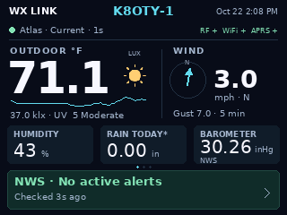

# CYD Weather Link

A single-controller weather-station appliance, currently supporting AcuRite Atlas, for the PanelLan
**ZX2D80CE02S-V10 / SC05_X** ESP32-S3 touchscreen and a 433 MHz CC1101 receiver.
Amateur-radio weather sharing is a primary use: direct APRS-IS/CWOP is separate
from optional D710 serial output. No Pi/gateway or SD card is required.

Development firmware includes a v2 Home display, swipeable 24-hour trends and
NWS forecasts/alerts, local-midnight rain, five-minute received wind peaks,
field-age/connection details, callsign/status header, protected browser setup,
embedded ZIP/map/elevation selection, persistence and opt-in sharing. A separate
seven-day archive retains five-minute summaries with browser/USB CSV export. Weather
Underground and Weathercloud adapters are implemented. Live CC1101 reception,
APRS.fi location/weather display and WU uploads are observed; the owner also
confirmed Weathercloud is receiving data. CWOP ingestion, reference comparison
and a full soak remain validation gates. Windy is later work; D710 serial, a
local barometer are optional additions. Sound is excluded from this device. Nearby NWS pressure is available as an attributed display fallback.

## Current development status

Firmware **v0.7.4** shows packet age beside the sensor state and uses
“Receiving” while building a complete weather cycle. Night forecast conditions
include a moon behind cloud, fog and precipitation artwork. The current
UI also includes configurable date/12–24-hour time, screen dim/off timeouts,
60-second Trends/Forecast return, full UV levels and original forecast icons.
The owner reports the v0.6.0 display/control changes passed their checks.
The dashboard hides “Get connected” after Wi-Fi, station confirmation and location
setup are complete; the top tabs remain available. It waits for device connection status on refresh before showing
Wi-Fi/NWS warnings. Local development and published GitHub releases may differ; see
[current work and remaining gates](firmware/WORK.md).

Choose a shared screen/webpage palette in **Station & Wi-Fi → Display & clock**:
Midnight (original), Matrix, Amber, Ice Blue, Violet, Paper or Night (low light). Preview locally,
then Save and restart to apply. Statuses are RF/WiFi/APRS/CWOP, with no sound icon.
Night adds subdued amber/olive colors and a lower backlight for dark rooms.
Forecast moons now follow the lunar cycle for their forecast period.
Watch/warning colors and stale-data indicators retain their meanings.

## Live display

Actual display capture from the owner's PanelLan board running v0.5.3,
with live Atlas reception. The weather icon and barometer use NWS data.

## 433 MHz station and sensor support

**Atlas is the only station currently supported for live readings, recording
and uploads. All other entries below are under development.** Iris and Notos
can already appear during automatic discovery, but cannot yet be selected.

This list covers the reviewed 433 MHz candidates from our pinned rtl_433 ESP
library. Some entries are individual sensors rather than complete stations.
Select the **433 MHz hardware variant** where a product also comes in 868 or
915 MHz versions; similar names and rebrands do not guarantee compatibility.

| Station / sensor type | Project status |
| --- | --- |
| **AcuRite Atlas** | **Supported — live RF, recording, APRS.fi, WU and Weathercloud ingestion owner-verified** |
| AcuRite Iris / legacy 5-in-1 | Under development — discovery preview |
| AcuRite Notos / 3-in-1 | Under development — discovery preview |
| Sainlogic SA8 / Gevanti SA8 | Under development |
| Fine Offset WH24 / WH65 / Ecowitt WS69 / MISOL WS2320 — 433 MHz variants | Under development — FSK receiver profile required |
| Fine Offset WH1080 / WH3080 — 433 MHz variants | Under development — OOK and FSK revisions differ |
| Cotech 36-7959 / SwitchDocLabs FT020T / Sainlogic WS019T and FT0300 / Ragova FT-0310 / NicetyMeter 0366 | Under development — verify exact revision |
| La Crosse WS-2310 / WS-3600 | Under development |
| La Crosse legacy TX — 433 MHz OOK sensors | Under development |
| EMOS E6016 / E6018 and E6016 rain sensor | Under development |
| Telldus FT0385R sensors | Under development |
| Ambient F007TH / TFA 30.3208.02 / SwitchDocLabs F016TH — 433 MHz variants | Under development |
| Auriol AFW2A1 | Under development |
| Esperanza EWS-103 | Under development |
| Globaltronics GT-WT-02 / GT-WT-03 | Under development |
| Cotech 36-7900 rain gauge | Under development |
| RainPoint HCS012ARF rain gauge | Under development |
| Schou 72543 / documented Motonet MTX, MarQuant, TFA and ADE rain-thermometer rebrands | Under development |
| EMOS TTX201 | Under development |
| Vauno EN8822C | Under development |
| Hyundai WS SENZOR | Under development |
| Kedsum / Pearl NC-7415 | Under development — tested upstream near 433.71 MHz |
| Homelead HG9901 soil/temperature/light sensor — documented EU variant | Under development |
| RainPoint soil temperature/moisture sensor | Under development |
| TBH weather sensor | Under development — FSK receiver profile required |
| Inkbird ITH-20R | Under development — FSK receiver profile required |

Under development means a decoder/integration candidate, **not a purchase-ready
compatibility claim**. Field mappings, integrity checks, receiver settings and
real hardware validation still apply. One radio cannot receive OOK and FSK
simultaneously. See the [decoder review and discovery plan](DECODER_SUPPORT.md),
[433 MHz inventory with source links](reference/decoder-inventory/433-weather.csv)
and [station research](STATION_SUPPORT.md) for exact scope and remaining work.

## Local browser address

After connecting to the station's setup Wi-Fi or the same home network, open
**http://wxlink.local**. The device's settings screen also shows its current
numeric IP as a fallback. This is a local HTTP address, with the existing admin
login; no domain registration or cloud redirect is involved. Name lookup needs
mDNS support and multicast on the local network; use the IP if unavailable.
The default name assumes one CYD Weather Link on that network.

## Start here

- [Firmware setup, build, upload and controls](firmware/README.md)
- [Exact CC1101 pinout: debug 3.3 V/GND and expansion signals](firmware/WIRING.md)
- [Owner touch/browser controls checklist](firmware/CONTROLS_CHECKLIST.md)
- [Current bench evidence and remaining checks](firmware/VALIDATION.md)
- [Embedded map sources, privacy and offline fallback](assets/web/README.md)
- [On-device recording, storage limits and CSV download](firmware/RECORDING.md)
- [Opt-in GitHub updates and release packaging](firmware/UPDATES.md)
- [Manufacturer PDFs](reference/README.md)

The firmware targets this exact board revision and pin map. Check the wiring
guide's supply assumptions before attaching a radio. UI replay and decoded
JSON tests do not prove live RF compatibility. Never present a replay as live
weather or upload it to a sharing network.

Configuration secrets live on the device, not in source. A custom admin
password is hidden; the visible setup Wi-Fi key is separate. Keep `captures/`
and full-flash backups private; they are ignored. Build outputs live in ignored
`firmware/.pio/`, and local release packaging writes ignored `dist/`.

Architecture, component choices and interface studies are documented in
[DESIGN.md](DESIGN.md), [PARTS.md](PARTS.md), [HOME_SCREEN.md](HOME_SCREEN.md),
[SCREENS.md](SCREENS.md) and [WEATHER_SHARING.md](WEATHER_SHARING.md).

## Licensing

Copyright (C) 2026 sideout909. Original project code is licensed under the
**GNU General Public License version 3 only (GPL-3.0-only)**; see [LICENSE](LICENSE).
You may use, modify and redistribute it, including commercially, under those
terms. This software is provided without warranty.

Third-party code, fonts, map assets and manufacturer references retain their
own notices and licenses; see [third-party notices](third_party/README.md).
